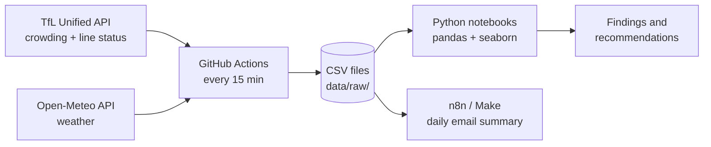

# London Tube Crowding: 30 Days of Live TfL Data

**When are London's busiest tube stations crowded, and what makes them busier than usual?**

I built a small data pipeline that checks 12 tube stations every 15 minutes.
It also saves line delays and the weather at the same time.
It runs for 30 days, from 10 Oct to 8 Nov 2026.
Then I analyse when stations get busy, and why.

> 🚧 **Status:** data collection in progress. Analysis and findings will be added after 8 November.

## Why this project
Anyone who uses the tube knows how bad a packed platform feels.
Crowding isn't just uncomfortable. It can slow trains down and become a safety risk.
TfL wants people to travel at quieter times, but that only works if people know when those times are.

I'm studying analytics, and I wanted a project that uses real, live data instead of a ready-made dataset.
This project lets me practise the whole process:
- calling APIs and handling errors
- automating data collection in the cloud
- checking data quality
- turning raw numbers into clear findings and advice

## Questions
1. When is each station busiest? How do weekdays compare with weekends?
2. Do office stations (Bank, Canary Wharf) behave differently from leisure stations (Leicester Square, Oxford Circus)?
3. When is a station busier or quieter than normal? Is that linked to delays, weather, events (football, Halloween, Bonfire Night), half-term or the clock change?
4. Which lines have the most delays, when, and why?

## How the pipeline works


- **Collect:** `scripts/collect.py` runs on GitHub Actions about every 15 minutes. Each run adds new rows to that day's CSV files. It runs in the cloud, so my laptop doesn't need to be on.
- **Store:** each run commits its data to this repo. This is called "git scraping". Every snapshot is saved in the history.
- **Reference:** `scripts/get_typical.py` downloads TfL's "typical" crowding pattern once. That's 7 days × 96 slots of 15 minutes for each station.
- **Analyse:** Jupyter notebooks in `notebooks/` (in progress).

## Data collected
| Dataset | Source | Endpoint | Frequency |
|---|---|---|---|
| Live station crowding | TfL Unified API | `/crowding/{naptan}/Live` | every 15 min |
| Line status and delay reasons | TfL Unified API | `/Line/Mode/tube,elizabeth-line,overground,dlr/Status` | every 15 min |
| Weather (central London) | Open-Meteo | `/v1/forecast` | every 15 min |
| Typical crowding pattern | TfL Unified API | `/crowding/{naptan}` | once |

**How crowding is measured:** `percentageOfBaseline` compares how busy a station is now with its busiest level since July 2019.
TfL's bands are: **under 0.4 = quiet**, **0.4–0.7 = busy**, **over 0.7 = very busy**.

## Stations
| Type | Stations |
|---|---|
| Commuter / offices | Waterloo, Liverpool Street, Bank, Canary Wharf |
| Rail interchange | King's Cross St Pancras, Victoria |
| Shopping / leisure | Oxford Circus, Leicester Square, Stratford |
| Tourist | Westminster |
| Events / football | Wembley Park, Finsbury Park |

## Repository structure
```
├── .github/workflows/collect.yml   # schedule (every 15 min)
├── scripts/collect.py              # collector
├── scripts/get_typical.py          # one-off: TfL typical pattern
├── data/raw/{crowding,status,weather}/YYYY-MM-DD.csv
├── data/reference/typical_crowding.csv
├── notebooks/                      # analysis (in progress)
└── reports/                        # findings (coming soon)
```

## Run it yourself
1. Get a free API key at [api-portal.tfl.gov.uk](https://api-portal.tfl.gov.uk/).
2. Make a `.env` file with `TFL_APP_KEY="your-key"`. Git ignores this file, so your key stays private.
3. Run `pip install -r requirements.txt`, then `python scripts/collect.py`.
4. For GitHub Actions, add the key as a repository secret called `TFL_APP_KEY`.

## Limitations (so far)
- **Crowding is relative.** Each station is compared with its own busiest level. So 0.6 at two stations doesn't mean the same number of people.
- **Tube only.** Live crowding only covers tube stations.
- **Arsenal has no live data.** I used Finsbury Park for match days instead.
- **Finsbury Park stopped too.** It returned data until about 02:00 on 14 Oct, then nothing. I kept it in the dataset and noted the gap.
- **Fewer runs than planned.** GitHub runs scheduled jobs "best effort". The first days had about 75 runs a day. By late October it was about 30 a day, not 96. Every row stores the real time TfL measured it, so the data is still accurate. There are just bigger gaps.
- **TfL's "typical" pattern looks old.** Its values are much lower than what I see live. It may come from the Covid recovery period. I use my own 30 days as the main "normal" and TfL's pattern only as a second comparison.
- **Links, not causes.** 30 days of data can show patterns. It can't prove what caused them.

## Findings
*Coming after the collection ends on 8 November 2026.*

## Use of AI
I used Claude (an AI assistant) as a helper on this project.
It helped me plan the pipeline, write and debug the Python scripts, and set up GitHub Actions.
It also helped me draft parts of this README.
I tested every script myself and checked the data it produced.
The analysis, conclusions and recommendations will be my own work.

## Data and attribution
Powered by TfL Open Data. Contains OS data © Crown copyright and database rights 2016, and Geomni UK Map data © and database rights 2019.
Weather data by [Open-Meteo.com](https://open-meteo.com/) (CC BY 4.0).

---
**Author:** Mihir · MSc Business Analytics, Warwick Business School · 2026/27
